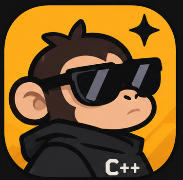

<p align="center">
  
</p>

<h1 align="center">C++ Visual IDE</h1>

IDE visual para C++ com Qt Widgets, no estilo Delphi/Lazarus. Este repositório contém a **IDE**; os projetos criados por ela são gerados em pastas separadas.

> **Primeira vez aqui?** Siga o [guia.md](guia.md): ele cria um projeto do zero, desenha uma tela de login, abre uma segunda tela depois do login e mostra como criar quantos formulários quiser.

## Estado atual — F0/F1/F2 concluídos

- [x] Estrutura de projeto (`project.json`, `app.vars.json`, `forms/*.ui`, `generated/`, `src/`)
- [x] Interface em `.ui` padrão Qt, compilada com `AUTOUIC` (posicionamento livre, alças, undo/redo e Object Inspector vêm do Qt Designer)
- [x] Gerador de código: `bindings.h`, `app_vars.h/.cpp`, `CMakeLists.txt`, slots e arquivos do usuário
- [x] Variáveis de runtime (carregadas de `app.vars.json`, sem `constexpr`)
- [x] Conexões no `.ui` (o `uic` gera os `connect`); o gerador acrescenta slots novos sem apagar o código escrito pelo usuário
- [x] Editor: numeração, linha atual, syntax highlight, auto-indentação, auto-fechar brackets, Ctrl+Space
- [x] F1: clangd/LSP — autocomplete, hover, ir para definição (F2) e diagnósticos sublinhados
- [x] Árvore de projeto (com área de arquivos C++ soltos para testes), salvamento, painéis Saída/Terminal/Build, compilação **assíncrona** (F7, sem travar a UI), Cancelar build (Shift+F7), Executar no terminal do sistema (F5) e Parar (Shift+F5)
- [x] Designer nativo (paleta, drag & drop, canvas e inspetor) como alternativa ao Qt Designer
- [x] Tema escuro único com paleta QSS, ícones e tela de boas-vindas
- [x] Arquivos C++ avulsos para teste: Ctrl+N cria, F6 compila com g++ e executa no terminal do sistema
- [x] F3: múltiplos formulários (`Projeto > Novo formulário...`, Ctrl+Shift+F), formulário ativo e navegação entre telas
- [ ] F4: depuração visual (breakpoints, inspeção de variáveis)

## Ambiente usado

- Qt 6.12 (MSYS2/MinGW-w64), CMake 4.5, Ninja 1.13
- Compilador: GCC 16.2 (MinGW-w64)
- clangd 23.1 (`pacman -S mingw-w64-x86_64-clang-tools-extra`) — necessário para intellisense; sem ele a IDE continua funcionando, mas sem autocomplete/diagnósticos
- Qt Designer (`pacman -S mingw-w64-x86_64-qt6-tools`) — necessário para `Projeto > Editar interface (Ctrl+D)`; o `uic` já vem com o Qt base

## Como compilar a IDE

No **MSYS2 MINGW64 Shell**:

```bash
cd /c/Users/joaof/Desktop/code/cpp/IDE
cmake -S . -B build -G Ninja -DCMAKE_BUILD_TYPE=Debug
cmake --build build
./build/CppVisualIDE.exe
```

Se preferir PowerShell/cmd, o `cmake` e o `g++` usados estão em `C:\msys64\mingw64\bin`. Após a compilação, o `windeployqt6` copia automaticamente os DLLs do Qt e o plugin `platforms/qwindows.dll` para a pasta do executável, então o `.exe` roda sem precisar configurar PATH. O mesmo vale para os projetos gerados pela IDE.

## Instalador (interface gráfica com barra de progresso)

Requer NSIS 3 (`winget install -e --id NSIS.NSIS`), já instalado nesta máquina.

```powershell
powershell -ExecutionPolicy Bypass -File installer\build-installer.ps1
```

Gera `installer\CppVisualIDE-Setup.exe`: assistente em português, páginas de boas-vindas/componentes/diretório/instalação com barra de progresso e opção de abrir a IDE ao final. Instala por padrão em `%LOCALAPPDATA%\Programs\CppVisualIDE` (sem precisar de administrador), cria atalhos (incluindo **Guia do iniciante**) e inclui `guia.md`, `README.md` e desinstalador. O instalador e o `.exe` usam o ícone do mascote (`installer\app.ico`) e incluem o `designer.exe`.

Para regerar o ícone a partir do PNG: `powershell -ExecutionPolicy Bypass -File scripts\make-app-icon.ps1`.

Instalação silenciosa (útil para teste):

```powershell
Start-Process .\installer\CppVisualIDE-Setup.exe -ArgumentList '/S', '/D=C:\Temp\CppVisualIDE' -Wait
```

## Dependências

Auditadas e atualizadas com `pacman -Syu` (MSYS2). Deploy automático pós-build:

- `windeployqt6` — DLLs do Qt + plugins (`platforms/qwindows.dll`, `styles`, `imageformats`, etc.)
- `scripts/deploy-runtime.ps1` — dependências do MinGW detectadas via `ldd` (`libstdc++`, `libgcc_s_seh`, `libicu*`, `libfreetype`, `libharfbuzz`, `libglib`, `zlib`, etc.)

O mesmo par de scripts é gerado dentro de cada projeto criado pela IDE (`tools/deploy-runtime.ps1`), então os `.exe` dos projetos também ficam independentes do PATH do MSYS2.

## Aparência

Os assets em `images\CppIDE_Assets\` são embutidos no executável por `resources.qrc` — não é preciso distribuir a pasta junto. A IDE usa apenas o tema escuro (`themes\dark.qss`) com as cores definidas:

- fundo `#242424`, painéis `#303030`, cards `#383838`, texto `#F2E6D5`, acento `#F5AE24`;
- apoio: sucesso `#78B94A`, erro `#E5534B`, texto secundário `#B8B8B8`, bordas `#737887`, detalhe rústico/mascote `#79513A`, seleção `#477CB8`.

A tela de boas-vindas e o editor usam cores sólidas da paleta, sem imagens de fundo. A área de arquivos é preta com letras brancas. Menu/toolbar, árvore, abas e painéis usam os ícones do pacote. QSS, paleta Qt e cores do syntax highlight são aplicados juntos na inicialização.

## Como usar

1. `Arquivo > Novo Projeto...` — escolha o nome e a pasta pai.
2. A IDE cria a estrutura (incluindo `forms\MainWindow.ui`), gera o código e abre os arquivos principais. A aba **Designer** aparece primeiro.
3. `Projeto > Editar interface` (Ctrl+D) abre o **Qt Designer** no `forms\<form>.ui`. Arraste componentes, positione livremente, redimensione com as alças, use o Object Inspector e crie conexões (sinal → slot) normalmente. Ao salvar no Designer, a IDE detecta a mudança, recarrega o formulário e regera o código automaticamente (undo/redo é o nativo do Qt Designer).
4. A aba **Designer** da própria IDE continua disponível: paleta, drag & drop, canvas e inspetor. Ela grava no mesmo `.ui`, com suporte a `$variavel` no inspetor.
5. `Projeto > Novo formulário...` (Ctrl+Shift+F) cria `forms\<Nome>.ui`, `src\<Nome>.h/.cpp` e `generated\bindings_<Nome>.h`, inclui tudo no `CMakeLists.txt` e torna o novo formulário o ativo. Use `Projeto > Formulário ativo` para alternar entre eles; o Ctrl+D sempre abre o ativo no Qt Designer. O primeiro formulário é o que `main.cpp` exibe ao iniciar. Veja o [guia.md](guia.md) para um exemplo completo de login → Home.
6. `Projeto > Gerar código` (Ctrl+G) regera `generated/`, o `CMakeLists.txt` e acrescenta slots novos em `src/` sem apagar o código que você escreveu nos slots existentes.
7. `Projeto > Compilar` (F7) executa CMake + Ninja em segundo plano: a IDE continua respondendo e a saída aparece em tempo real na aba **Build**. Pressione F7 novamente (ou `Shift+F7`) para cancelar. Se o executável ainda não existir, F5 compila antes e só inicia o programa quando o build terminar.
8. `Projeto > Executar` (F5) inicia `build\<projeto>.exe` em uma janela do **terminal do sistema** (`cmd.exe` no Windows); a saída vai para essa janela, não fica presa na IDE. `Shift+F5` encerra o processo.
9. Para testes rápidos sem projeto: `Arquivo > Novo arquivo C++ para teste...` (Ctrl+N) cria um `.cpp` em `Documentos\CppIDE-Testes`. O nó **Arquivos C++ soltos (testes)** na árvore mostra esses arquivos (e qualquer `.cpp/.h` aberto via `Arquivo > Abrir arquivo C++...`). Dê duplo clique para editar; `Ctrl+S` salva.
10. Com um `.cpp` aberto, `Arquivo > Compilar e executar arquivo (teste)` (F6) roda `g++ -std=c++20 -Wall` em segundo plano (saída na aba **Build**) e, se compilar, abre o `.exe` no terminal do sistema.
11. No editor: `Ctrl+Space` abre o autocomplete do clangd, `F2` vai para a definição, passar o mouse mostra a documentação e erros aparecem sublinhados.
12. Também é possível abrir um projeto direto: `CppVisualIDE.exe "C:\caminho\project.json"`.

## Variáveis em runtime

`app.vars.json` é copiado para junto do executável na compilação:

```json
{
  "alturaBotao": 32,
  "corPrimaria": "#2d7d9a",
  "titulo": "MeuProjeto"
}
```

No formulário, uma propriedade pode referenciar uma variável:

```json
"minimumHeight": { "$var": "alturaBotao" }
```

O binding fica no `project.json` (o `.ui` guarda apenas um valor neutro). O gerador emite `generated/bindings.h` com `applyBindings(host, &ui)` para o primeiro formulário e `generated/bindings_<Nome>.h` com `applyBindings_<Nome>(host, &ui)` para os demais, sempre chamados logo após `ui.setupUi(this)`. Assim, alterar `app.vars.json` em runtime — ou chamar `vars().load(...)` novamente seguido da função de bindings do formulário — reaplica todos os valores ligados às variáveis.
