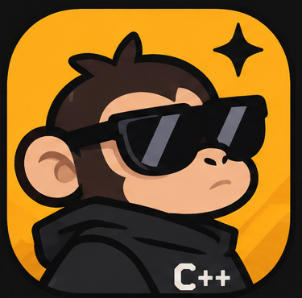

<p align="center">
  
</p>

<h1 align="center">Guia do C++ Visual IDE</h1>

Este guia leva você do zero até um programa com **duas telas**: uma tela de login e uma tela inicial ("Home") aberta depois do login. Ao final você também saberá criar quantos formulários quiser.

> O login deste exemplo é apenas demonstrativo: ele aceita qualquer usuário/senha preenchidos. A ideia é mostrar como um botão de um formulário abre outro.

---

## 1. Antes de começar

Você precisa ter:

- a IDE compilada (`build\CppVisualIDE.exe`) ou o instalador executado;
- **Qt Designer** disponível (`C:\msys64\mingw64\bin\designer.exe`, instalado com `pacman -S mingw-w64-x86_64-qt6-tools`) para desenhar as telas;
- **clangd** apenas se quiser autocomplete e diagnósticos (`pacman -S mingw-w64-x86_64-clang-tools-extra`). Sem ele a IDE funciona normalmente.

Abra a IDE. Se aparecer a tela com o mascote, você ainda não tem projeto aberto — isso é normal.

---

## 2. Conhecendo a janela

| Parte | Onde fica | Para que serve |
|---|---|---|
| **Árvore de arquivos** (esquerda, fundo preto) | painel lateral | duplo clique abre arquivos; mostra o projeto e a área **Arquivos C++ soltos (testes)** |
| **Editor** (centro) | abas com nome de arquivo | escreva código C++ aqui; `Ctrl+Space` autocompleta |
| **Designer** (aba "Designer") | primeira aba do editor | paleta, drag & drop e inspetor da IDE |
| **Saída / Terminal / Build** (embaixo) | abas | mensagens da IDE / janela do sistema / saída do compilador |
| **Barra de ferramentas** | topo | atalhos para novo projeto, novo formulário, Designer, gerar, compilar, executar |

### Atalhos que você vai usar

| Atalho | Ação |
|---|---|
| `Ctrl+Shift+N` | Novo projeto |
| `Ctrl+Shift+F` | **Novo formulário** |
| `Ctrl+D` | Abrir o formulário ativo no Qt Designer |
| `Ctrl+G` | Gerar código |
| `F7` | Compilar (gera o código antes) |
| `Shift+F7` | Cancelar compilação |
| `F5` | Executar (abre o programa no terminal do sistema) |
| `Shift+F5` | Parar execução |
| `Ctrl+S` | Salvar |
| `Ctrl+Space` / `F2` | Autocomplete / ir para definição |

---

## 3. Crie o projeto

1. `Arquivo > Novo Projeto...` (`Ctrl+Shift+N`).
2. Nome: `LoginDemo`. Escolha uma pasta pai (por exemplo `Documentos`) e confirme.
3. A IDE cria a estrutura e abre os arquivos:

```
LoginDemo/
├─ project.json          ← lista de formulários, variáveis e bindings
├─ app.vars.json         ← valores lidos em runtime
├─ forms/
│  └─ MainWindow.ui      ← o formulário desenhado
├─ src/
│  ├─ main.cpp           ← ponto de entrada (abre o 1º formulário)
│  ├─ MainWindow.h       ← declaração da classe e dos slots
│  └─ MainWindow.cpp     ← SEU CÓDIGO: corpo dos eventos
├─ generated/
│  ├─ bindings.h         ← aplica app.vars.json
│  ├─ app_vars.h/.cpp
│  └─ (build/) ui_MainWindow.h  ← gerado pelo uic a partir do .ui
└─ CMakeLists.txt
```

O primeiro formulário se chama `MainWindow` e vai ser nossa **tela de login**.

**Regra de ouro:** o `.ui` é a fonte da verdade da interface. O `uic` gera os `connect(...)` a partir dele — **não escreva `connect` na mão**, senão a conexão fica duplicada.

---

## 4. Desenhe a tela de login

1. Com o projeto aberto, pressione `Ctrl+D` (`Projeto > Editar interface (Qt Designer)`).
2. O Qt Designer abre `forms\MainWindow.ui`. O formulário já vem com três widgets:
   - `tituloLabel` (QLabel)
   - `inputNome` (QLineEdit)
   - `btnOk` (QPushButton) — **já possui a conexão `clicked() → on_btnOk_clicked()`**
3. Ajuste no Designer:
   - `tituloLabel`: `text` = `Login`
   - `inputNome`: `placeholderText` = `Usuário`
   - `btnOk`: `text` = `Entrar`
4. Arraste um segundo **QLineEdit** do painel de widgets para o formulário e mude o `objectName` dele para `inputSenha` (no Object Inspector, à direita).
5. Salve no Designer (`Ctrl+S`). A IDE detecta a mudança, recarrega o formulário e regera o código sozinha.

> **Criando conexões para botões novos:** clique com o botão direito no botão → **Go to slot / Ir para slot…** → `clicked()` → OK. O nome do slot segue o `objectName`: um botão `btnEntrar` gera `on_btnEntrar_clicked()`. Depois aperte `Ctrl+G` na IDE para que o gerador acrescente a declaração no `.h` e o corpo no `.cpp`.

---

## 5. Crie o segundo formulário

1. Volte à IDE e pressione `Ctrl+Shift+F` (`Projeto > Novo formulário...`).
2. Digite `HomeWindow` e confirme.

A IDE cria e abre automaticamente:

```
forms/HomeWindow.ui
src/HomeWindow.h
src/HomeWindow.cpp
generated/bindings_HomeWindow.h
```

E atualiza o `CMakeLists.txt` para compilar o novo formulário. O `HomeWindow` fica como **formulário ativo**.

Para trocar o formulário ativo use `Projeto > Formulário ativo` (marcado com ✓) ou dê duplo clique no `.ui` correspondente na árvore. O `Ctrl+D` sempre abre o formulário ativo no Qt Designer.

---

## 6. Desenhe a tela Home

1. Com `HomeWindow` ativo, `Ctrl+D`.
2. Arraste um **QLabel** para o formulário e chame-o de `mensagem` (objectName). Deixe o texto inicial como `Bem-vindo!`.
3. Arraste um **QPushButton**, chame-o de `btnSair` e coloque `text` = `Sair`.
4. Clique direito em `btnSair` → **Ir para slot** → `clicked()` → OK.
5. Salve no Designer. Volte à IDE e aperte `Ctrl+G` para criar o slot `on_btnSair_clicked()`.

---

## 7. Escreva o código da navegação

### 7.1 Tela de login — `src\MainWindow.cpp`

Abra `src\MainWindow.cpp` na árvore. Adicione o include do outro formulário e substitua o corpo do slot:

```cpp
#include "MainWindow.h"

#include <QMessageBox>
#include "bindings.h"
#include "HomeWindow.h"        // ← adicione

#include <QPushButton>

MainWindow::MainWindow(QWidget* parent)
    : QWidget(parent)
{
    ui.setupUi(this);
    applyBindings(this, &ui);
    ui.inputSenha->setEchoMode(QLineEdit::Password); // opcional: esconder a senha
}

void MainWindow::on_btnOk_clicked()
{
    const QString usuario = ui.inputNome->text().trimmed();
    const QString senha = ui.inputSenha->text();
    if (usuario.isEmpty() || senha.isEmpty()) {
        QMessageBox::warning(this, QStringLiteral("Login"),
                             QStringLiteral("Informe usuário e senha."));
        return;
    }

    // parentWidget() continua apontando para o login (serve para voltar depois).
    // Qt::Window é necessário: sem isso, esconder o login também esconderia a Home.
    auto *home = new HomeWindow(this);
    home->setWindowFlag(Qt::Window);
    home->setUsuario(usuario);
    hide();
    home->show();
}
```

### 7.2 Tela Home — `src\HomeWindow.h`

Adicione um método público na classe (dentro de `public:`):

```cpp
public:
    explicit HomeWindow(QWidget* parent = nullptr);
    void setUsuario(const QString &usuario);   // ← adicione
```

### 7.3 Tela Home — `src\HomeWindow.cpp`

```cpp
#include "HomeWindow.h"

#include <QMessageBox>
#include "bindings_HomeWindow.h"
#include "MainWindow.h"        // ← adicione, para voltar ao login

#include <QPushButton>

HomeWindow::HomeWindow(QWidget* parent)
    : QWidget(parent)
{
    ui.setupUi(this);
    applyBindings_HomeWindow(this, &ui);
}

void HomeWindow::setUsuario(const QString &usuario)
{
    ui.mensagem->setText(QStringLiteral("Bem-vindo, %1!").arg(usuario));
}

void HomeWindow::on_btnSair_clicked()
{
    close(); // esconde a Home (o parent ainda a possui)
    if (auto *login = qobject_cast<MainWindow *>(parentWidget())) {
        login->show();
    }
}
```

> O gerador **preserva** o que você escreve nesses arquivos. Ele só acrescenta declarações, includes de bindings e slots que ainda não existem. Pode substituir os `// TODO` sem medo.

---

## 8. Compile e execute

1. `Ctrl+S` para salvar.
2. `F7` — a IDE roda `Ctrl+G` automaticamente e depois `cmake -S . -B build` + `cmake --build build` **em segundo plano**. A saída aparece em tempo real na aba **Build**; a janela continua respondendo.
3. `F5` — o `build\LoginDemo.exe` abre em uma **janela do terminal do sistema** (`cmd.exe`). `Shift+F5` encerra.
4. Teste: preencha `Ana` e qualquer senha → clique **Entrar** → aparece `Bem-vindo, Ana!`. Clique **Sair** → volta ao login.

Se algo falhar, veja a mensagem na aba **Build** (erros de compilação) ou **Saída** (erros da IDE).

---

## 9. Criando mais formulários

O fluxo é sempre o mesmo:

1. `Ctrl+Shift+F` → nome da classe (letras, números e `_`, começando com letra ou `_`; sem espaços e sem repetir nome).
2. O novo formulário fica ativo. Use `Projeto > Formulário ativo` para alternar entre eles.
3. `Ctrl+D` desenha o ativo no Qt Designer; salvar regera automaticamente.
4. Escreva a lógica em `src\<Nome>.h/.cpp`, chame o outro formulário com `#include "OutroForm.h"` e `new OutroForm(this)`.
5. `F7` compila tudo; `F5` executa.

Cada formulário gera:

| Arquivo | Papel |
|---|---|
| `forms\<Nome>.ui` | interface + conexões (editar no Designer) |
| `src\<Nome>.h` | classe, slots, métodos que você adiciona |
| `src\<Nome>.cpp` | corpo dos slots |
| `generated\bindings_<Nome>.h` | bindings das variáveis (`applyBindings_<Nome>`) |

O **primeiro** formulário é o que `src\main.cpp` abre na inicialização e usa `generated\bindings.h` (com `applyBindings`). Para mudar a tela inicial, edite `src\main.cpp`:

```cpp
HomeWindow window;   // troque MainWindow por HomeWindow
window.show();
```

O gerador não sobrescreve `main.cpp` depois que ele existe.

---

## 10. Gerar código × Compilar

| | `Ctrl+G` (Gerar código) | `F7` (Compilar) |
|---|---|---|
| O que faz | reescreve `generated/`, `CMakeLists.txt`, acrescenta slots novos em `src/` | **chama Gerar código** e depois CMake + Ninja |
| Saída | aba **Saída** | aba **Build** |
| Gera `.exe`? | não | sim |

Na prática você usa `F7`. Use `Ctrl+G` sozinho quando quiser só conferir os fontes gerados após mexer no `.ui`.

---

## 11. Solução de problemas rápida

| Sintoma | Solução |
|---|---|
| Meu slot não aparece no `.cpp` | Aperte `Ctrl+G`; o gerador adiciona a declaração no `.h` e o corpo no `.cpp`. |
| Botão clicado não faz nada | Verifique se a conexão existe no `.ui` ( Designer → clique direito → Ir para slot ) e se o nome do slot é `on_<objectName>_clicked()`. |
| Dois eventos Disparam | Você escreveu `connect(...)` na mão. Remova: o `uic` já conecta. |
| Designer salvou mas nada mudou | A IDE observa o `.ui` e regera sozinha; se precisar, `Ctrl+G`. |
| `g++/cmake não encontrado` | Use o MSYS2 MINGW64 (os binários ficam em `C:\msys64\mingw64\bin`). |
| Quero testes sem projeto | `Ctrl+N` cria um `.cpp` em `Documentos\CppIDE-Testes`; `F6` compila com `g++` e abre no terminal do sistema. |
| Quero mudar cores/texto sem recompilar | Edite `app.vars.json`; as propriedades ligadas a `$var` são reaplicadas em runtime. |

---

## 12. Resumo do fluxo

```
Novo projeto (Ctrl+Shift+N)
   ↓
Desenhar tela no Qt Designer (Ctrl+D) → salvar
   ↓
Novo formulário (Ctrl+Shift+F) → desenhar → salvar
   ↓
Escrever slots em src/*.cpp
   ↓
Compilar (F7) → Executar (F5) → terminal do sistema
```

Consulte também o [`README.md`](README.md) para detalhes de instalação, variáveis em runtime e arquitetura do gerador.
